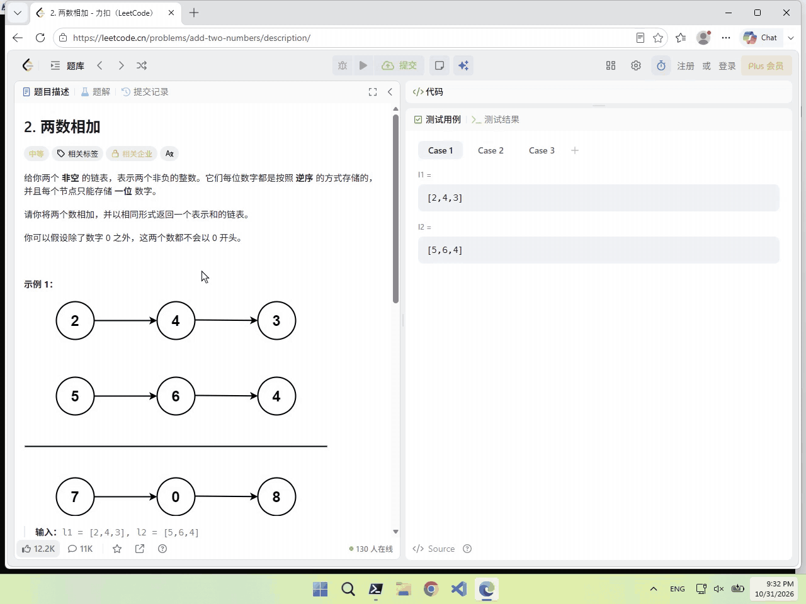
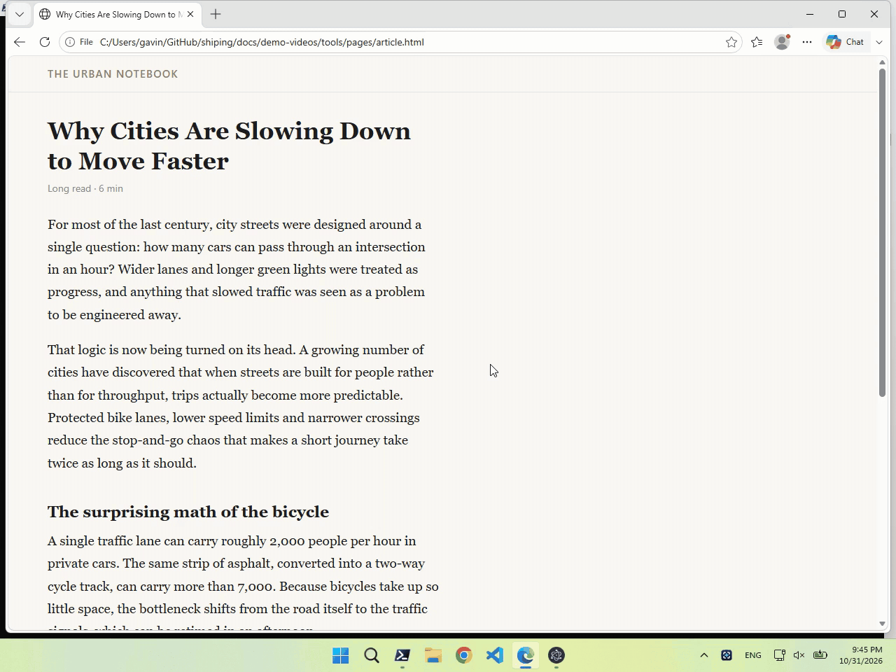
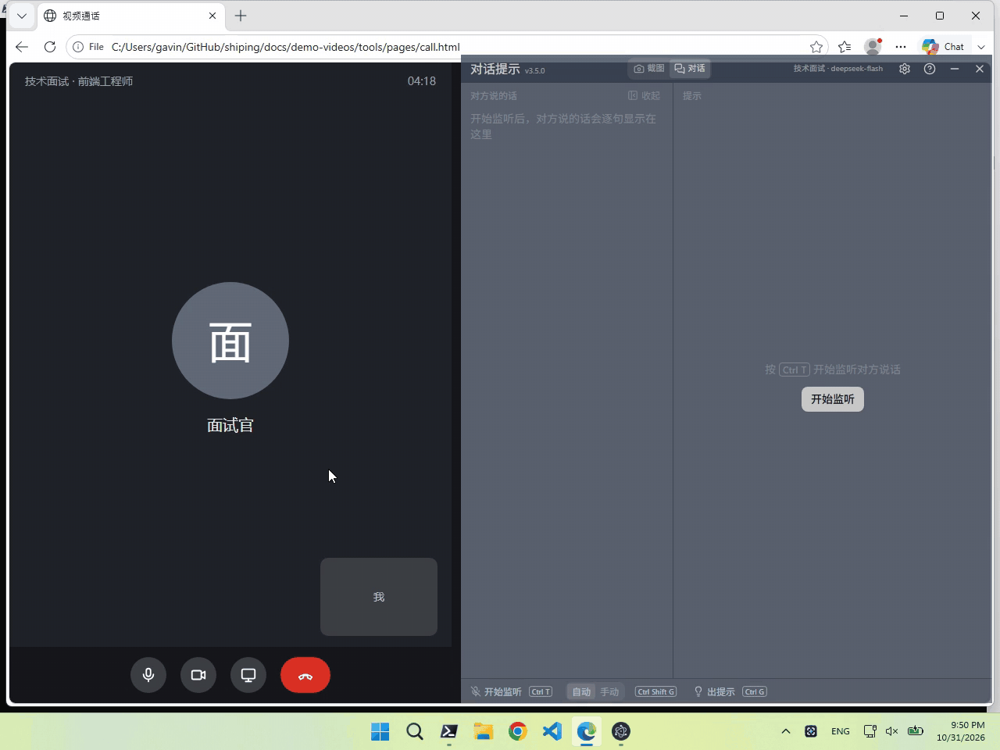
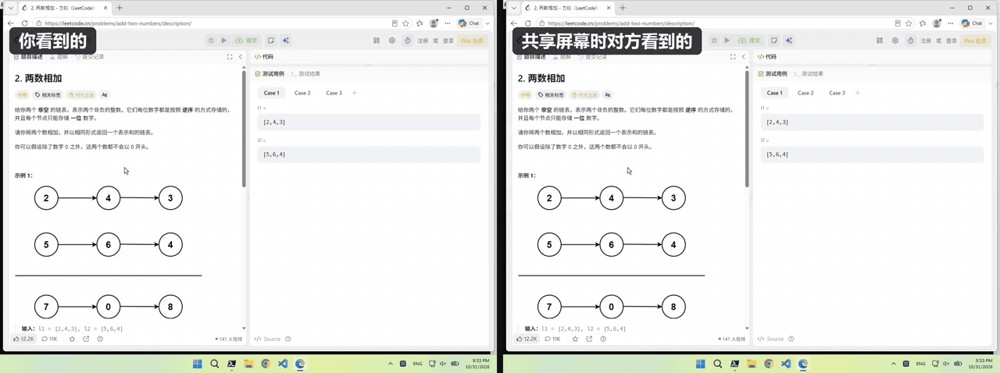

# 识屏 Shiping

> 屏幕上的内容，截一下、框一下，AI 就看懂：题目、代码、报错、图表、外文资料，按下快捷键就有解答。平时常驻后台，随叫随到；听对话时，对方说完就有提示。窗口不会出现在屏幕共享和录屏画面里，你的内容和隐私不外露。开源，用你自己的 AI 平台和 API Key，没有订阅费。

> 本项目原名「截屏解题助手」（仓库 `interview-coder-cn`），2026 年 10 月改名为「识屏 Shiping」。功能不变，旧仓库地址自动跳转，升级后原有设置自动保留。

## 功能一览

### 截图模式

按 `⌥ Enter`（Windows 为 `Ctrl+Enter`）截取屏幕，视觉模型流式给出解答。题目一屏放不下就按 `⌥⇧ Enter`（Windows 为 `Ctrl+Shift+Enter`）追加截图，也可以追问，上下文连续。



### 框选识别

按 `⌥⇧ S`（Windows 为 `Ctrl+Alt+S`）或单击菜单栏（Windows 为通知区域）里的识屏图标，拖出要识别的一块，松开鼠标就有解答；看完按 `Esc`，窗口隐藏，键盘回到原来的应用。看不懂的代码、报错、图表、外文，框出来就有解释或翻译。识屏因此可以常驻后台，窗口隐藏时只占用「隐藏 / 显示窗口」和「框选识别」两个快捷键。



### 对话模式

实时识别对方说的话，对方说完一句，右侧就出提示：一句能直接说出口的开场，加几个要点。采集的是系统音频，线上会议里就是对方的声音，自己说话不会触发；也可以按 `⌥ G`（Windows 为 `Ctrl+G`）随时出提示。

使用前在[百炼控制台](https://help.aliyun.com/zh/model-studio/get-api-key)创建 API Key 填到「设置 → 语音」（Fun-ASR 实时识别，约 0.02 元/分钟），点窗口顶部的「对话」切过去，按 `⌥ T`（Windows 为 `Ctrl+T`）开始监听。



### 隐身模式：共享屏幕时保护隐私

开会演示、远程协作、直播录屏时，屏幕上难免有不想让别人看到的东西：和 AI 的对话、资料库里的简历和笔记。隐身模式让识屏的窗口不出现在屏幕共享和录屏画面里，你照常看、照常用，别人只看到窗口底下的内容（下图左边是你看到的，右边是对方看到的）。

隐身模式默认开启，可以在「设置 → 界面与隐私」关闭。腾讯会议等大部分会议软件都适用，少数软件和浏览器仍可能拍到窗口，共享前请用自己的电脑和会议软件确认一下。菜单栏 / 托盘图标不在隐身范围内，也可以在同一处隐藏。



隐身效果因电脑和软件而异，你的测试结果欢迎到 [Telegram 群](https://t.me/shipingexe) 或 [#21](https://github.com/ooboqoo/shiping/issues/21) 分享。

## 适用场景

| 场景                               | 用法                                                         |
| ---------------------------------- | ------------------------------------------------------------ |
| 看不懂的代码、报错、图表、外文资料 | 框选识别（「通用问答」场景）：解释、翻译、总结               |
| 算法笔试 / 在线编程题              | 截图模式「解算法题」：思路和完整代码，默认用 TypeScript      |
| 英语机试 / 能力测评 / 其他在线考试 | 截图模式「英语考试」「能力测评」「通用问答」                 |
| 技术面试                           | 对话模式「技术面试」；对方共享编程题时按 `⌥⇧ M` 切到截图模式 |
| HR 面 / 英文面试                   | 对话模式「行为面试」「英文面试」                             |
| 以上都不是                         | 在设置里新增自定义场景，写自己的提示词                       |

## 快速开始

1. **下载安装**：到 [Releases](https://github.com/ooboqoo/shiping/releases) 下载，Windows 用 `setup.exe`，macOS 用 `.dmg`（目前只有 Apple 芯片版本，Intel 芯片请[从源码运行](#从源码运行)）。首次打开的注意事项见 [Wiki 教程](https://github.com/ooboqoo/shiping/wiki/%E7%9B%B4%E6%8E%A5%E4%B8%8B%E8%BD%BD%E5%AE%89%E8%A3%85%E5%8C%85%E4%BD%BF%E7%94%A8)
2. **配置 AI**：首次打开会提示填写 `API Base URL` 和 `API Key`。推荐 [DeepSeek](https://platform.deepseek.com/)，地址已经默认选好，填上 API Key 即可，两种模式都能用；其他兼容 OpenAI API 的平台也可以，如 [OpenRouter](https://openrouter.ai/)、OpenAI 官方（只填 `API Key`）、[硅基流动](https://cloud.siliconflow.cn/i/SG8C0772)。常用平台的填法见 Wiki 的[对照表](https://github.com/ooboqoo/shiping/wiki/AI%E6%A8%A1%E5%9E%8B%E9%85%8D%E7%BD%AE%E4%B8%8E%E8%B0%83%E7%94%A8%E5%A4%B1%E8%B4%A5#%E5%B8%B8%E7%94%A8%E5%B9%B3%E5%8F%B0%E7%9A%84%E5%A1%AB%E6%B3%95)
3. **为两种模式选模型**：「设置 → AI 模型」可以保存多套配置，再到「截图模式」「对话模式」分别选用。截图模式需要**能识图的模型**，对话模式建议选打开「关闭思考」的**快模型**

AI 请求默认跟随系统代理（含 PAC），可以在「设置 → 网络代理」改成自定义代理（HTTP / HTTPS / SOCKS5）或直连。平台或网关要求额外请求头的（如 Azure 的 `api-key`），在配置的「高级 → 自定义请求头」里每行填一个 `名称: 值`。

## 更多功能

- **资料库**：在「设置 → 资料库」导入简历、项目笔记（PDF、Word、Markdown、TXT），或粘贴准备好的问答，AI 作答时优先参考，每份资料可以分别用于两种模式。资料只保存在本机，但会随每次请求发给 AI 平台，建议每个模式不超过 3 万字
- **手机同步**：在「设置 → 手机同步」打开后，解答和提示实时同步到手机浏览器，电脑屏幕上可以不留窗口，电脑上按翻页快捷键手机跟着翻。同一 Wi-Fi 下扫设置页的二维码即可，用流量看需要自己的服务器跑中转服务（见 [relay/README.md](relay/README.md)）。二维码链接相当于只读密码，别外发，泄露了点「更换二维码」
- **不打扰手上的事**：窗口置顶半透明，当前页面不会失焦；可以开鼠标穿透，快捷键冲突时用悬浮工具条点按钮操作
- **对话记录**：在「设置 → 对话模式」打开「保存对话记录到本地」，每段对话存成一个 Markdown 文件，方便复盘

## 常用快捷键

| 操作                       | macOS       | Windows             |
| -------------------------- | ----------- | ------------------- |
| 截图解题（新开对话）       | `⌥ Enter`   | `Ctrl+Enter`        |
| 框选识别（框一块区域解答） | `⌥⇧ S`      | `Ctrl+Alt+S`        |
| 追加截图                   | `⌥⇧ Enter`  | `Ctrl+Shift+Enter`  |
| 对话模式：出提示           | `⌥ G`       | `Ctrl+G`            |
| 对话模式：切换自动 / 手动  | `⌥⇧ G`      | `Ctrl+Shift+G`      |
| 语音转录 / 开始停止监听    | `⌥ T`       | `Ctrl+T`            |
| 停止生成                   | `⌥ .`       | `Ctrl+.`            |
| 切换截图 / 对话模式        | `⌥⇧ M`      | `Ctrl+Shift+M`      |
| 隐藏 / 显示窗口            | `⌥ H`       | `Ctrl+H`            |
| 鼠标穿透                   | `⌥ M`       | `Ctrl+M`            |
| 上翻 / 下翻（手机同步翻）  | `⌘J` / `⌘K` | `Ctrl+J` / `Ctrl+K` |

所有快捷键都可以在「设置 → 快捷键」里修改或清除，完整列表见应用内的「帮助中心」。

## 遇到问题

先看报错原文：截图模式在答案区顶部的「API 调用失败」下面，对话模式在提示卡片的「生成失败：……」里。常见问题整理在 Wiki 里：

- [AI 模型配置与调用失败](https://github.com/ooboqoo/shiping/wiki/AI%E6%A8%A1%E5%9E%8B%E9%85%8D%E7%BD%AE%E4%B8%8E%E8%B0%83%E7%94%A8%E5%A4%B1%E8%B4%A5)：404、401、模型名不对、模型看不到截图、一直「正在生成」、中转站的 Key 用不了
- [截图问题](https://github.com/ooboqoo/shiping/wiki/%E6%88%AA%E5%9B%BE%E9%97%AE%E9%A2%98)：截错屏幕、只截题目区域、截图是黑的、截图没保存
- [窗口与快捷键问题](https://github.com/ooboqoo/shiping/wiki/%E7%AA%97%E5%8F%A3%E4%B8%8E%E5%BF%AB%E6%8D%B7%E9%94%AE%E9%97%AE%E9%A2%98)：网页全屏时透明度跳变、启动就崩溃、快捷键没反应
- [语音与对话模式](https://github.com/ooboqoo/shiping/wiki/%E8%AF%AD%E9%9F%B3%E4%B8%8E%E5%AF%B9%E8%AF%9D%E6%A8%A1%E5%BC%8F)：识别不到声音、转录后 AI 不回答、对话模式不出提示
- **手机同步打不开**：电脑能打开、手机打不开，多半是防火墙没放行。Windows 到「Windows 安全中心 → 防火墙和网络保护 → 允许应用通过防火墙」给本应用勾上当前网络那一列（专用 / 公用分开算），macOS 到「系统设置 → 网络 → 防火墙 → 选项」允许传入连接；手机不要连访客网络，先关掉手机上的代理 / VPN。换了 Wi-Fi 需要重新扫码

没找到答案再[提 Issue](https://github.com/ooboqoo/shiping/issues/new)，请附上软件版本、操作系统、所用平台和模型，以及报错原文（API Key 记得打码）。日常使用交流可以加 [Telegram 群](https://t.me/shipingexe)。

## 从源码运行

需要先安装 [Node.js](https://nodejs.org/zh-cn/download)：

```bash
npm install
npm run dev         # 开发模式运行
npm run build:mac   # 打包 macOS 安装包
npm run build:win   # 打包 Windows 安装包
```

可以在项目根目录创建 `.env` 预配置 AI 平台，启动时作为默认值：

```env
API_BASE_URL="https://openrouter.ai/api/v1"
API_KEY="sk-1234567890"
MODEL="gpt-5-mini" # 可选
```

## 许可协议

[CC BY-NC 4.0](LICENSE)：可以自由使用、修改和分发，注明出处即可，但不得用于商业用途（包括售卖、集成进商业产品或 SaaS 服务），商业授权请联系作者。请遵守所在场合的规则和相关法律法规，使用本软件产生的后果由使用者自行承担。
